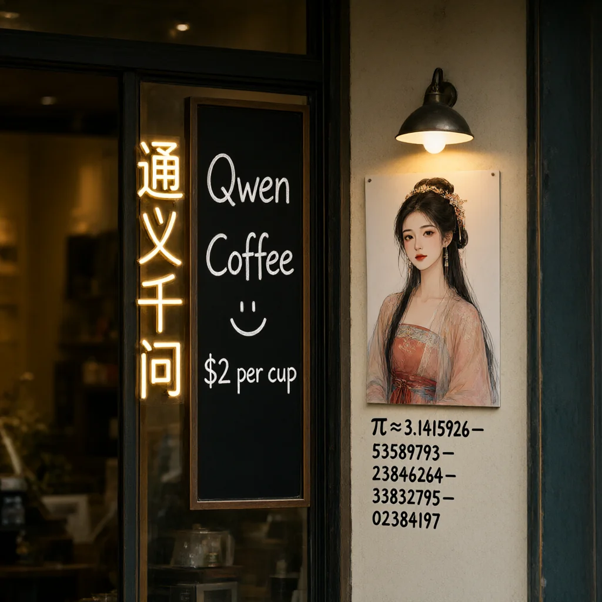

# VigenFlow

**FLUX, Z-Image, Krea 2 and Qwen Image on the NPU of an AMD Ryzen AI laptop, several times faster than the same laptop's integrated GPU.**

Local image generation and editing with **CPU + AMD NPU inference**, used through **OpenWebUI**.

💬 **[Join our Discord](https://discord.gg/EhDtAAahv)** to ask questions, share your creations, and discuss VigenFlow.

> **New: one-command install.** On Windows or Ubuntu, a single command installs VigenFlow and OpenWebUI and downloads the models you choose. See [Quick Install](#-quick-install).

The latest release, **[v0.2.0 Beta 3](https://github.com/jia1217/vigenflow/releases/latest)**, adds **Qwen Image 2.1 Turbo** for text-to-image and image editing, bringing VigenFlow to seven models. All models use **BFP16 weights**, and **image editing** is served next to the text-to-image models.

---

## 🎨 Gallery

One example per text-to-image model, plus image-editing examples, all generated by VigenFlow on the NPU at 1024 × 1024. Click an image, or open the **[full gallery](docs/gallery.md)**, for more examples and the exact prompts.

<!-- One image per text-to-image model here, up to five per row; the editing table below shows an input image and its edits. Each model's full set and prompts go in docs/gallery.md. -->
<table>
  <tr>
    <td width="20%" align="center" valign="top"><a href="docs/gallery.md#flux1-schnell"></a><br><sub><b>FLUX.1-schnell</b></sub></td>
    <td width="20%" align="center" valign="top"><a href="docs/gallery.md#flux2-klein-4b"></a><br><sub><b>FLUX.2-klein-4B</b></sub></td>
    <td width="20%" align="center" valign="top"><a href="docs/gallery.md#krea-2-turbo"></a><br><sub><b>Krea 2 Turbo</b></sub></td>
    <td width="20%" align="center" valign="top"><a href="docs/gallery.md#qwen-image-21-turbo"></a><br><sub><b>Qwen Image 2.1 Turbo</b></sub></td>
    <td width="20%" align="center" valign="top"><a href="docs/gallery.md#z-image-turbo"></a><br><sub><b>Z-Image-Turbo</b></sub></td>
  </tr>
</table>

**Image editing** with Qwen Image 2.1 Turbo Edit, starting from the Krea 2 Turbo image above:

<table>
  <tr>
    <td width="25%" align="center" valign="top"><a href="docs/gallery.md#qwen-image-21-turbo-edit"></a><br><sub><b>Input image</b></sub></td>
    <td width="25%" align="center" valign="top"><a href="docs/gallery.md#qwen-image-21-turbo-edit"></a><br><sub><b>Full-body shot</b></sub></td>
    <td width="25%" align="center" valign="top"><a href="docs/gallery.md#qwen-image-21-turbo-edit"></a><br><sub><b>Manga style</b></sub></td>
    <td width="25%" align="center" valign="top"><a href="docs/gallery.md#qwen-image-21-turbo-edit"></a><br><sub><b>Pink dress</b></sub></td>
  </tr>
</table>

---

## 🎬 Demo

- ⚡ **[v0.2 speed demo](https://www.youtube.com/watch?v=2mQH2Q0H6Nc&list=PLcZNuhm1Td94)**: VigenFlow generating images on the NPU.
- 🛠️ **[Setup walkthrough](https://youtu.be/kZaqCE0LnRA?si=5h6zOFKBfm6EKJv9)**: how to set up and use VigenFlow with OpenWebUI Desktop.
<!-- - 📱 **[Short demo](https://youtube.com/shorts/dwDsCnBObzQ?si=Aq4BZV3zcW51KjQa)** -->

> **Note:** VigenFlow is tested with Open WebUI **v0.11.4**. If you use a different version and run into compatibility issues, switch to v0.11.4.

---

## 🧠 Supported Models

| Model | Model ID | Task | Denoising steps | Time per image |
| --- | --- | --- | ---: | ---: |
| **FLUX.1-schnell** | `flux1-schnell` | Text-to-image | 4 | ~20 s |
| **FLUX.2-klein-4B** | `flux2-klein-4B` | Text-to-image | 4 | ~9 s |
| **FLUX.2-klein-4B Edit** | `flux2-klein-4B-edit` | Image-to-image | 4 | ~18 s |
| **Krea 2 Turbo** | `krea2-turbo` | Text-to-image | 8 | ~50 s |
| **Z-Image-Turbo** | `z-image-turbo` | Text-to-image | 4 or 8 | ~18 s |
| **Qwen Image 2.1 Turbo** | `qwen-image-2.1-turbo` | Text-to-image | 8 | ~35 s |
| **Qwen Image 2.1 Turbo Edit** | `qwen-image-2.1-turbo-edit` | Image-to-image | 8 | ~52 s |

All models use BFP16 weights and make 1024 × 1024 images. All seven models run on Windows and Ubuntu. You can switch between installed workers in the OpenWebUI model list without restarting `vgf-serve`.

The times are approximate, for one 1024 × 1024 image on an AMD Ryzen AI 9 HX 370, with prompts encoded at 512 text tokens.

Krea 2 Turbo's weights are under the [Krea 2 Community License](https://www.krea.ai/krea-2-licensing), not Apache-2.0, and its commercial use is limited; see [MODEL_LICENSES.md](MODEL_LICENSES.md). The Flux and Z-Image models in the table above are Apache-2.0. The opt-in Qwen Image 2.1 Turbo weights use the Qwen RESEARCH LICENSE AGREEMENT (research/evaluation only; separate license required for commercial use).

### Compared with AMD Ryzen AI Software 1.8

AMD's [Ryzen AI Software 1.8](https://ryzenai.docs.amd.com/en/latest/sd_demo.html) runs FLUX.1-schnell and FLUX.2-klein-4B on the NPU as preview demos. On the same Ryzen AI 9 HX 370, VigenFlow is faster with prompts twice as long, and it also runs three models that Ryzen AI 1.8 does not:

| Model | VigenFlow | Ryzen AI Software 1.8 |
| --- | --- | --- |
| FLUX.1-schnell | ~20 s, 512 text tokens | ~23 s, 256 text tokens |
| FLUX.2-klein-4B | ~9 s, 512 text tokens | ~10 s, 256 text tokens |
| FLUX.2-klein-4B Edit | ~18 s | Not supported |
| Krea 2 Turbo | ~50 s | Not supported |
| Z-Image-Turbo | ~18 s | Not supported |

All times are for one 1024 × 1024 image, and both FLUX comparisons use 4 steps. In our tests, Ryzen AI 1.8's FLUX demos accept prompts of up to 256 text tokens. At the same 256 text tokens, VigenFlow's FLUX.2-klein-4B takes about 8 s; VigenFlow ships only the 512-token version so that longer prompts fit.

---

## 🔜 Next Steps

Planned for a future release:

- [ ] **SeedVR2** and **VOSR2** support for image upscaling.
- [ ] **LoRA support** for the BFP16 model pipelines. If you need LoRA today, use [v0.1.2](https://github.com/jia1217/vigenflow/releases/tag/v0.1.2).

Which model should come next? Vote in [issue #4](https://github.com/jia1217/vigenflow/issues/4).

---

## 🚀 Getting Started

You need:

- [ ] **An AMD Ryzen AI 300-series processor** with an XDNA 2 NPU (`npu2`). VigenFlow is tested on the [AMD Ryzen AI 9 HX 370](https://www.amd.com/en/newsroom/press-releases/2024-10-10-amd-launches-new-ryzen-ai-pro-300-series-processo.html); other processors need matching NPU binaries and runtime support.
- [ ] **Windows x64 or Ubuntu 24.04 x86_64.**
- [ ] **Free disk space for the models you want:** 8 GB for FLUX.2-klein-4B alone, about 65 GB for the original four weight sets, or about 85 GB including Qwen, plus up to 10 GB while they download. [Step 3](#-step-3-download-the-model-weights-one-time) lists each model's size.
- [ ] **The NPU driver**, installed once as shown below.

### 🔌 Install the NPU Driver (One Time)

#### 🪟 Windows

Install the NPU driver from AMD's [Driver Download](https://www.amd.com/en/support/download/drivers.html) page, then restart. **NPU Compute Accelerator Device** should then appear in Device Manager.

#### 🐧 Ubuntu

Install the AMD XDNA driver and XRT from the [Lemonade PPA](https://launchpad.net/~lemonade-team/+archive/ubuntu/stable), then reboot:

```bash
sudo add-apt-repository ppa:lemonade-team/stable
sudo apt update
sudo apt install amdxdna-dkms libxrt-npu2 libxrt-utils
sudo reboot
```

After the reboot, `xrt-smi examine` should list the NPU.

Ubuntu has no official XRT packages. The PPA's `amdxdna-dkms` driver replaces the one built into the kernel, which does not work with XRT 2.25 on some kernels (see [Troubleshooting](#-troubleshooting)). The Ubuntu Quick Install needs only `amdxdna-dkms`, and offers to install it for you.

### 🧭 Choose How to Install

- **[Quick Install](#-quick-install), recommended:** one command installs VigenFlow and OpenWebUI and downloads the models you choose.
- **[Release packages](#-installation):** download and start each part yourself. For these you also need [OpenWebUI Desktop](https://github.com/open-webui/desktop).

---

## ⚡ Quick Install

The quickest way to try VigenFlow: one command installs it, downloads the models you choose, and starts it together with OpenWebUI. Press Enter at the model question for FLUX.2-klein-4B (8 GB), the fastest. Run the same command again to update VigenFlow or add models.

### 🪟 Windows

Install the [NPU driver](#-install-the-npu-driver-one-time) first. Then, in PowerShell:

```powershell
irm https://raw.githubusercontent.com/jia1217/vigenflow/main/install.ps1 | iex
```

The installer checks the NPU driver, downloads the latest release, asks for an install folder and which models to download, and starts VigenFlow and OpenWebUI in their own windows. OpenWebUI runs with [uv](https://github.com/astral-sh/uv), so you need neither Docker nor Python; its first start downloads about 2 GB and takes several minutes, then it opens in your browser. If Windows Firewall asks about `vgf-serve.exe`, either answer works for use on this PC. After a restart, start both again from the Start menu, under VigenFlow.

### 🐧 Ubuntu (Docker or Podman)

```bash
curl -fsSL https://raw.githubusercontent.com/jia1217/vigenflow/main/docker/install.sh | bash
```

The installer checks for the NPU driver and offers to install it, installs Docker if you have neither Docker nor Podman, asks which models to download, and starts VigenFlow together with OpenWebUI. When it finishes, open the address it prints, usually http://localhost:8080. [docs/docker.md](docs/docker.md) shows the same steps by hand, with Podman and Docker Compose.

To use the release packages instead, follow the steps below.

---

## 📦 Installation

Download the package for your system, extract it, download the model weights once, and start the server. The weights are not included in the packages; Step 3 downloads them from Hugging Face.

### 📥 Step 1: Download the Release Package

Go to the [Latest Release](https://github.com/jia1217/vigenflow/releases/latest) page and download the package for your operating system:

- 🐧 Ubuntu: `vigenflow_0.2.0-beta.2_ubuntu_amd64.zip`
- 🪟 Windows: `vigenflow_0.2.0-beta.2_windows_amd64.zip`

To be notified about new releases, click **Watch → Custom → Releases** on the [VigenFlow repository](https://github.com/jia1217/vigenflow) page.

### 📂 Step 2: Extract the Package

Extract the downloaded `.zip` package on a drive with room for the model weights. Step 3 saves them next to the extracted folder, not inside it.

#### 🐧 Ubuntu

The Ubuntu package needs a few runtime libraries. XRT comes with the [AMD XDNA driver installation](#-install-the-npu-driver-one-time).

```bash
sudo apt install libboost-program-options1.83.0 libgomp1 libpng16-16t64 curl unzip
unzip vigenflow_0.2.0-beta.2_ubuntu_amd64.zip
cd vigenflow_0.2.0-beta.2_ubuntu_amd64
```

#### 🪟 Windows

Extract the ZIP package manually, then open **PowerShell** inside the extracted `vigenflow_0.2.0-beta.2_windows_amd64` folder.

### 💾 Step 3: Download the Model Weights (One Time)

`prepare_base.exe` downloads the pre-packed NPU weights from Hugging Face and saves them in an `all_model_weights` folder **next to** the extracted package folder, so a later VigenFlow version extracted in the same place uses the same weights. Each model has its own repository: [FLUX.1-schnell](https://huggingface.co/Kelsey1217/FLUX.1-schnell-NPU-BFP16), [FLUX.2-klein-4B](https://huggingface.co/Kelsey1217/FLUX.2-klein-4B-NPU-BFP16), [Z-Image-Turbo](https://huggingface.co/Kelsey1217/Z-Image-Turbo-NPU-BFP16) and [Krea 2 Turbo](https://huggingface.co/Kelsey1217/Krea-2-Turbo-NPU-BFP16). No Hugging Face account is needed.

#### 🐧 Ubuntu

```bash
./prepare/prepare_base.exe
```

#### 🪟 Windows

```powershell
.\prepare\prepare_base.exe
```

When the download reaches Krea 2 Turbo, `prepare_base.exe` shows the Krea license links and waits for you to type `I agree`. Any other answer skips that model.

All four sets of weights together are about **65 GB** (FLUX.1-schnell 27 GB, Krea 2 Turbo 19 GB, Z-Image-Turbo 12 GB, FLUX.2-klein-4B 8 GB), plus up to 10 GB of free space while downloading. The edit model uses the FLUX.2-klein-4B weights.

To download only some models, name their weight folders with `--only`, for example `prepare_base.exe --only flux2_klein_4B,z_image_turbo`. The names are `flux1_schnell`, `flux2_klein_4B`, `z_image_turbo` and `krea2_turbo`. To skip a model on every run, set `"enabled": false` for it in `prepare/prepare_models.jsonc` instead.

`qwen_image_2_1_turbo` downloads the public [NPU+CPU weight package](https://huggingface.co/Kelsey1217/Qwen-Image-2.1-Turbo-NPU-BFP16)
at a pinned, verified revision. It remains opt-in and adds 19.59 GB when selected with
`--only qwen_image_2_1_turbo`; the tool asks for acceptance of the Qwen research license.
Both Qwen server models share this weight folder. See the
[preparation instructions](src/prepare_weights/README.md#qwen-image-21-turbo)
and [server setup](src/server_unified/README.md#qwen-image-21-turbo).

If you used v0.2.0 Beta 1, move its `all_model_weights` folder so that it sits next to the new package folder before you run the command. The three models you already have are then not downloaded again.

You can run `prepare_base.exe` again at any time. It only downloads models whose weights have changed, and it resumes an interrupted download.

### ▶️ Step 4: Launch VigenFlow Server

All models are served at once, so you don't need to give a model name when starting the server.

#### 🐧 Ubuntu

```bash
cd server_running
./vgf-serve
```

#### 🪟 Windows

```powershell
cd server_running
.\vgf-serve.exe
```

The server listens on port **11283** and makes all supported models available to OpenWebUI. To see all server options, run `./vgf-serve -h` (Ubuntu) or `.\vgf-serve.exe -h` (Windows).

The default model is `z-image-turbo`. If you did not download its weights, start the server with `--model` and the ID of a model you have, for example `--model flux2-klein-4B`.

---

## 🔗 Connect with OpenWebUI Desktop

After launching `vgf-serve`, open **OpenWebUI Desktop** and configure it for your local VigenFlow server. All settings below are in OpenWebUI's **Admin Panel → Settings**.

1. **Add the connection.** In **Connections**, add an OpenAI API connection with this URL:

   ```text
   http://127.0.0.1:11283/v1
   ```

   Keep **API Type** set to **Chat Completions** (the default). No API key is needed. The VigenFlow models then appear in the model list.
2. **Turn on image generation.** In **Images**, turn on **Image Generation**, keep the engine set to **OpenAI**, set the API base URL to `http://127.0.0.1:11283/v1`, and type any text as the API key, then click **Save**. OpenWebUI will not save this setting without a key; VigenFlow ignores it.
3. **Set up each model.** In **Models**, edit each VigenFlow model:
   - Set **Function Calling** to **Native** in its advanced parameters. Recent OpenWebUI versions already use Native by default.
   - Keep **Image Generation** and **Builtin Tools** checked under Capabilities.
   - For `flux2-klein-4B-edit`, also check **Vision** so you can attach images.
4. **Generate an image.** In a chat, pick a VigenFlow model, open **Integrations** in the message box and turn on **Image**, then type your prompt.

The screenshot shows the **Images** settings page set up for VigenFlow.


---

## 🔧 Troubleshooting

### Ubuntu: `run.exe failed with exit code 134` for every model

The AMD XDNA driver built into some Linux kernels rejects the messages that XRT 2.25 sends to the NPU. This was reported on kernel `7.0.0-38`. Every model worker then stops, `vgf-serve` prints `run.exe failed with exit code 134`, and `sudo dmesg` shows lines like these:

```text
Message callback ret -22
Channel in bad state
```

To fix it, install the driver from the Lemonade PPA and reboot. The `amdxdna-dkms` package builds the driver for your kernel, and it is loaded instead of the built-in one:

```bash
sudo add-apt-repository ppa:lemonade-team/stable
sudo apt update
sudo apt install amdxdna-dkms
sudo reboot
```

After the reboot, `modinfo -n amdxdna` should print a path that contains `updates/dkms`, and `xrt-smi examine` should list the NPU.

---

## 📄 License

The VigenFlow source code is licensed under the [Apache License 2.0](LICENSE).

Model weights are **not** covered by this license. Each model and LoRA keeps its original license, including the BFP16 weights in the release packages. See [MODEL_LICENSES.md](MODEL_LICENSES.md) for each model's license and whether it allows commercial use. Third-party libraries are listed in [THIRD_PARTY_NOTICES.md](THIRD_PARTY_NOTICES.md).
