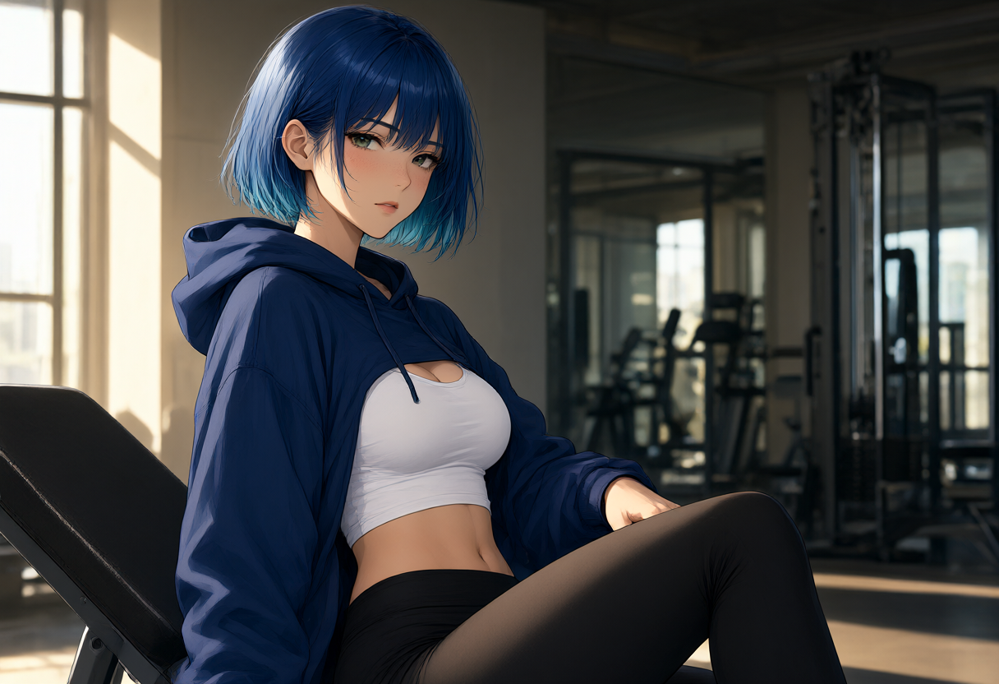
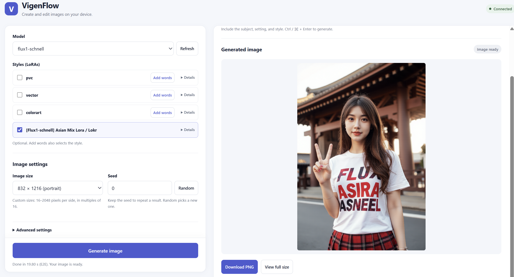
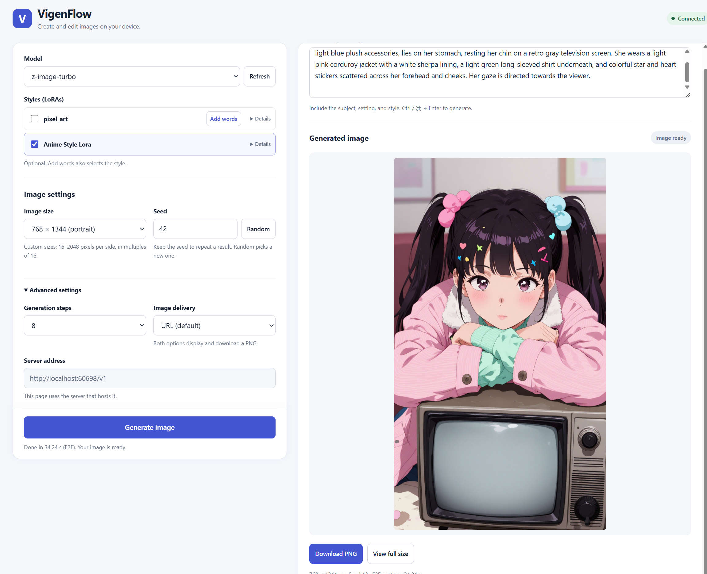
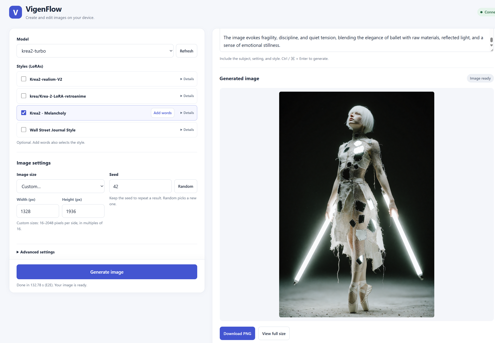
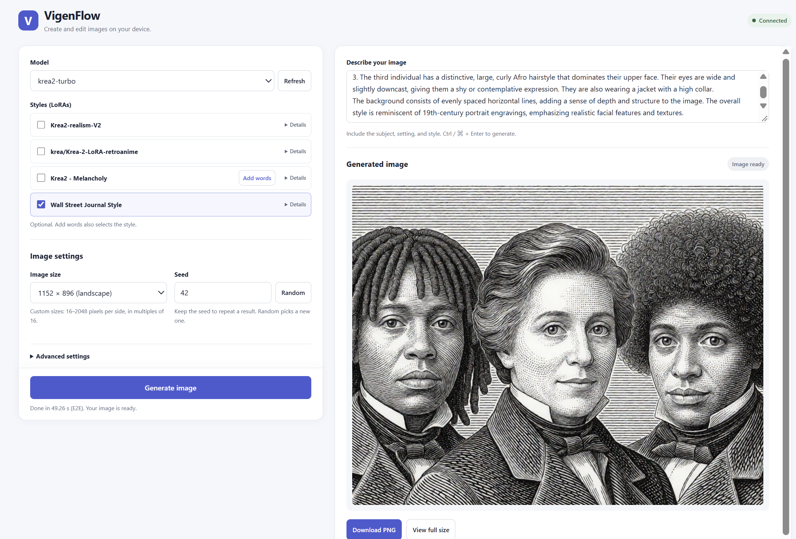
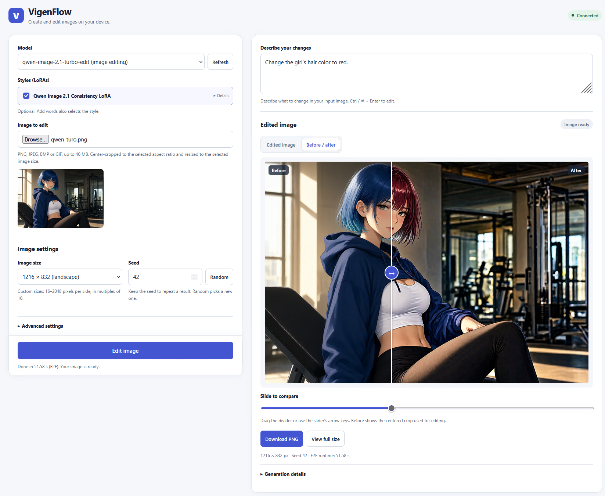
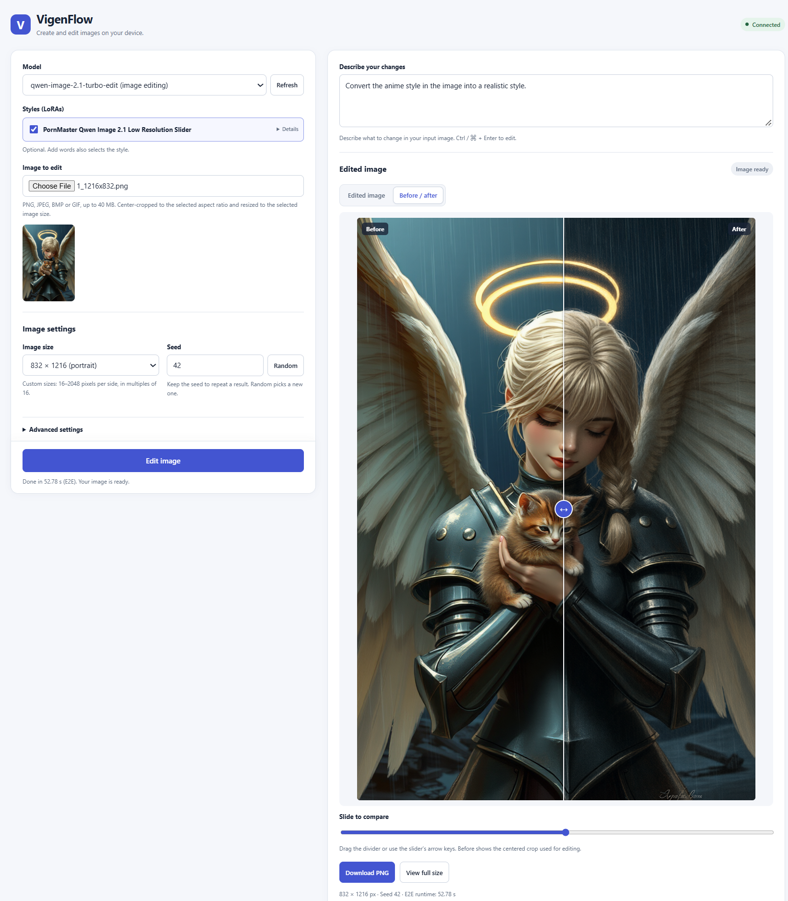
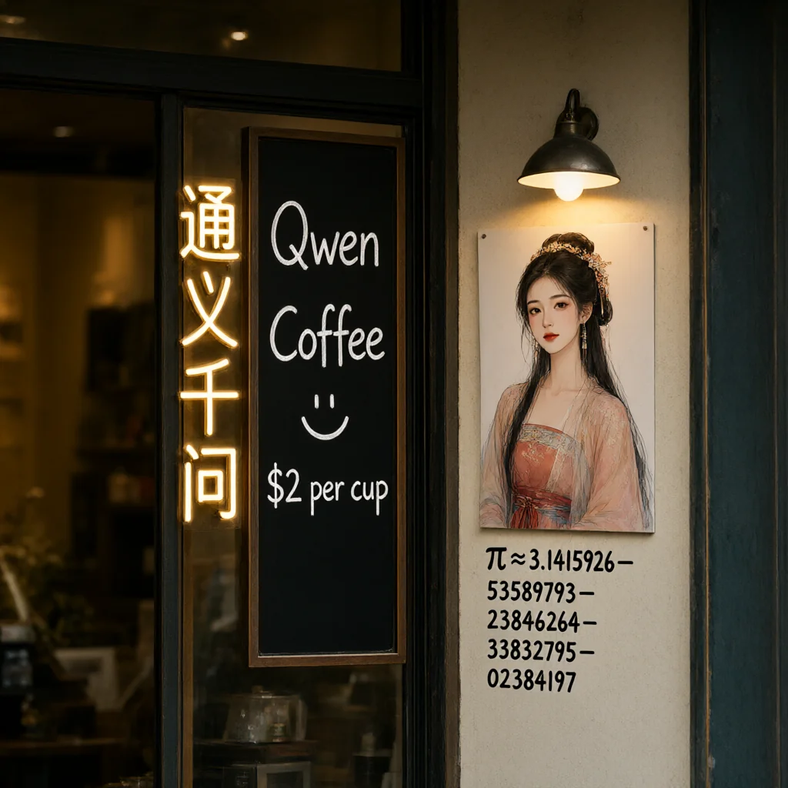
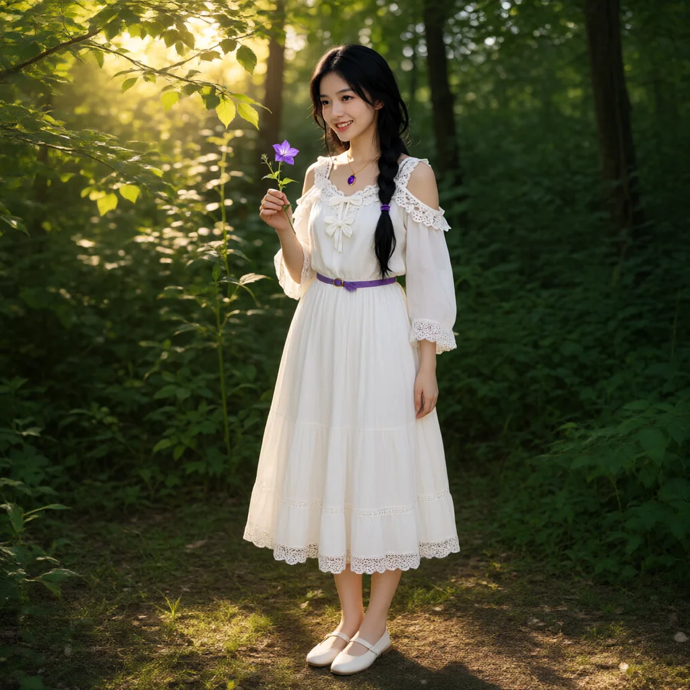

# VigenFlow [](https://discord.gg/87DnMjsccu)

**Create images locally with AMD NPU acceleration and a built-in browser UI.**

**[v0.2.0 Beta 4 — FLUX.1-schnell prerelease](https://github.com/jia1217/vigenflow/releases/tag/v0.2.0-beta.4)** brings prompts, LoRA styles, image settings, previews, and PNG downloads together in your browser. This package supports **FLUX.1-schnell on Ubuntu x86-64**, using **CPU + AMD NPU inference**. OpenWebUI is optional.

> **Coming soon:** Windows builds and support for additional models in **Beta 4**, with the built-in browser UI.

- 🎨 **LoRA styles:** select styles and add their trigger words, or configure your own LoRAs through `loras.jsonc`.
- 🖼️ **Custom resolutions:** 16–2048 pixels per side, in multiples of 16, for square, portrait, and landscape images.
- ⚡ **Two memory modes:** Balanced reduces RAM usage; Performance keeps weights and reusable buffers loaded for faster subsequent images.
- ⏱️ **Visible timings:** E2E runtime in seconds beside the seed and in the completion message, with stage timings below the image.

**[Download Beta 4](https://github.com/jia1217/vigenflow/releases/download/v0.2.0-beta.4/vgf_0.2.0-beta.4_ubuntu_amd64_flux1.zip)** · **[Get started](https://github.com/jia1217/vigenflow/releases/tag/v0.2.0-beta.4)** · **[Beta 4 examples](#-beta-4-examples)**

> **Upgrading from Beta 3?** The model weight paths are unchanged. Extract Beta 4 beside your existing `all_model_weights` folder to reuse `all_model_weights/flux1_schnell` without downloading the weights again.

VigenFlow also supports **FLUX.2, Z-Image, Krea 2, and Qwen Image** for generation and editing. The **[Beta 3 packages](https://github.com/jia1217/vigenflow/releases/tag/v0.2.0-beta.3)** include all seven models on Windows and Ubuntu; the Beta 4 prerelease above includes **FLUX.1-schnell only**. The existing [Quick Install](docs/quick-install.md) installs the multi-model release with OpenWebUI.

---

## 🖼️ Beta 4 Examples

These examples preview **Beta 4's built-in web UI**, with **LoRA styles**, **custom image sizes**, and **image editing with a before/after comparison**. The Windows build and additional Beta 4 models shown here are previews of upcoming support. Click any image to open the original PNG at full size.

### Generated images

<table>
  <tr>
    <td width="33%" align="center" valign="top"><a href="assets/examples/beta4/flux1-figure.png"></a><br><sub><b>FLUX.1-schnell</b><br>Figure-style portrait</sub></td>
    <td width="33%" align="center" valign="top"><a href="assets/examples/beta4/qwen-moonlit-portrait.png"></a><br><sub><b>Qwen Image 2.1 Turbo</b><br>Moonlit anime portrait</sub></td>
    <td width="33%" align="center" valign="top"><a href="assets/examples/beta4/qwen-gym-portrait.png"></a><br><sub><b>Qwen Image 2.1 Turbo</b><br>Input for the hair-color edit below</sub></td>
  </tr>
</table>

### LoRA styles in the web UI

The screenshots show the selected model, style, image size, and result.

<table>
  <tr>
    <td width="50%" align="center" valign="top"><a href="assets/examples/beta4/flux1-asian-mix.png"></a><br><sub><b>FLUX.1-schnell · Asian Mix LoRA / LoKr</b><br>832 × 1216</sub></td>
    <td width="50%" align="center" valign="top"><a href="assets/examples/beta4/z-image-anime.png"></a><br><sub><b>Z-Image-Turbo · Anime Style LoRA</b><br>768 × 1344 · 8 steps</sub></td>
  </tr>
  <tr>
    <td width="50%" align="center" valign="top"><a href="assets/examples/beta4/krea2-melancholy.png"></a><br><sub><b>Krea 2 Turbo · Melancholy</b><br>1328 × 1936 custom size</sub></td>
    <td width="50%" align="center" valign="top"><a href="assets/examples/beta4/krea2-engraved-portraits.png"></a><br><sub><b>Krea 2 Turbo · Wall Street Journal Style</b><br>1152 × 896</sub></td>
  </tr>
</table>

### Image editing in the web UI

**Qwen Image 2.1 Turbo Edit** examples with the built-in before/after comparison. The prompts are shown beneath each screenshot.

<table>
  <tr>
    <td width="50%" align="center" valign="top"><a href="assets/examples/beta4/qwen-edit-hair-color.png"></a><br><sub><b>Hair-color change · Consistency LoRA</b><br>1216 × 832<br>Change the girl's hair color to red.</sub></td>
    <td width="50%" align="center" valign="top"><a href="assets/examples/beta4/qwen-edit-realistic-style.png"></a><br><sub><b>Anime-to-realistic style conversion</b><br>832 × 1216<br>Convert the anime style in the image into a realistic style.</sub></td>
  </tr>
</table>

---

## 🎨 Gallery

### More models and image editing · Beta 3

The multi-model release includes the examples below, generated on the NPU at **1024 × 1024**. Click an image, or open the **[full gallery](docs/gallery.md)**, for more examples and the exact prompts. These additional models are available in Beta 3, outside the FLUX.1-only Beta 4 package.

<!-- One image per text-to-image model here, up to five per row; the editing table below shows an input image and its edits. Each model's full set and prompts go in docs/gallery.md. -->
<table>
  <tr>
    <td width="20%" align="center" valign="top"><a href="docs/gallery.md#flux1-schnell"></a><br><sub><b>FLUX.1-schnell</b></sub></td>
    <td width="20%" align="center" valign="top"><a href="docs/gallery.md#flux2-klein-4b"></a><br><sub><b>FLUX.2-klein-4B</b></sub></td>
    <td width="20%" align="center" valign="top"><a href="docs/gallery.md#krea-2-turbo"></a><br><sub><b>Krea 2 Turbo</b></sub></td>
    <td width="20%" align="center" valign="top"><a href="docs/gallery.md#qwen-image-21-turbo"></a><br><sub><b>Qwen Image 2.1 Turbo</b></sub></td>
    <td width="20%" align="center" valign="top"><a href="docs/gallery.md#z-image-turbo"></a><br><sub><b>Z-Image-Turbo</b></sub></td>
  </tr>
</table>

**Image editing** with Qwen Image 2.1 Turbo Edit, starting from the Krea 2 Turbo image above:

<table>
  <tr>
    <td width="25%" align="center" valign="top"><a href="docs/gallery.md#qwen-image-21-turbo-edit"></a><br><sub><b>Input image</b></sub></td>
    <td width="25%" align="center" valign="top"><a href="docs/gallery.md#qwen-image-21-turbo-edit"></a><br><sub><b>Full-body shot</b></sub></td>
    <td width="25%" align="center" valign="top"><a href="docs/gallery.md#qwen-image-21-turbo-edit"></a><br><sub><b>Manga style</b></sub></td>
    <td width="25%" align="center" valign="top"><a href="docs/gallery.md#qwen-image-21-turbo-edit"></a><br><sub><b>Pink dress</b></sub></td>
  </tr>
</table>

---

## 🎬 Demo

- ⚡ **[v0.2 speed demo](https://www.youtube.com/watch?v=2mQH2Q0H6Nc&list=PLcZNuhm1Td94)**: VigenFlow generating images on the NPU.
- 🛠️ **[Setup walkthrough](https://youtu.be/kZaqCE0LnRA?si=5h6zOFKBfm6EKJv9)**: how to set up and use VigenFlow with OpenWebUI Desktop.
<!-- - 📱 **[Short demo](https://youtube.com/shorts/dwDsCnBObzQ?si=Aq4BZV3zcW51KjQa)** -->

> **Note:** VigenFlow is tested with Open WebUI **v0.11.4**. If you use a different version and run into compatibility issues, switch to v0.11.4.

---

## 🧠 Supported Models

The table below describes the **Beta 3 multi-model packages** for Windows and Ubuntu. **Beta 4 currently packages FLUX.1-schnell only for Ubuntu**, with LoRAs, custom resolutions, and Balanced/Performance memory modes.

### 🖼️ Text-to-Image

| Model | Model ID | Denoising steps | Time per image | Windows | Ubuntu |
| --- | --- | ---: | ---: | :---: | :---: |
| **FLUX.1-schnell** | `flux1-schnell` | 4 | ~20 s | ✅ | ✅ |
| **FLUX.2-klein-4B** | `flux2-klein-4B` | 4 | ~9 s | ✅ | ✅ |
| **Krea 2 Turbo** | `krea2-turbo` | 8 | ~48 s | ✅ | ✅ |
| **Z-Image-Turbo** | `z-image-turbo` | 4 or 8 | ~18 s | ✅ | ✅ |
| **Qwen Image 2.1 Turbo** | `qwen-image-2.1-turbo` | 8 | ~35 s | ✅ | ✅ |

### ✏️ Image-to-Image (Editing)

| Model | Model ID | Denoising steps | Time per image | Windows | Ubuntu |
| --- | --- | ---: | ---: | :---: | :---: |
| **FLUX.2-klein-4B Edit** | `flux2-klein-4B-edit` | 4 | ~18 s | ✅ | ✅ |
| **Qwen Image 2.1 Turbo Edit** | `qwen-image-2.1-turbo-edit` | 8 | ~52 s | ✅ | ✅ |

All models use BFP16 weights. The Beta 3 workers make 1024 × 1024 images; Beta 4's FLUX.1-schnell worker also supports custom resolutions. You can switch between installed workers in the OpenWebUI model list without restarting `vgf-serve`.

The times are approximate, for one 1024 × 1024 image on an AMD Ryzen AI 9 HX 370, with prompts encoded at 512 text tokens.

Krea 2 Turbo's weights are under the [Krea 2 Community License](https://www.krea.ai/krea-2-licensing), not Apache-2.0, and its commercial use is limited; see [MODEL_LICENSES.md](MODEL_LICENSES.md). The Flux and Z-Image models in the table above are Apache-2.0. The opt-in Qwen Image 2.1 Turbo weights use the Qwen RESEARCH LICENSE AGREEMENT (research/evaluation only; separate license required for commercial use).

### Compared with AMD Ryzen AI Software 1.8

AMD's [Ryzen AI Software 1.8](https://ryzenai.docs.amd.com/en/latest/sd_demo.html) runs FLUX.1-schnell and FLUX.2-klein-4B on the NPU as preview demos. On the same Ryzen AI 9 HX 370, VigenFlow is faster with prompts twice as long, and it also runs three models that Ryzen AI 1.8 does not:

| Model | VigenFlow | Ryzen AI Software 1.8 |
| --- | --- | --- |
| FLUX.1-schnell | ~20 s, 512 text tokens | ~23 s, 256 text tokens |
| FLUX.2-klein-4B | ~9 s, 512 text tokens | ~10 s, 256 text tokens |
| FLUX.2-klein-4B Edit | ~18 s | Not supported |
| Krea 2 Turbo | ~48 s | Not supported |
| Z-Image-Turbo | ~18 s | Not supported |

All times are for one 1024 × 1024 image, and both FLUX comparisons use 4 steps. In our tests, Ryzen AI 1.8's FLUX demos accept prompts of up to 256 text tokens. At the same 256 text tokens, VigenFlow's FLUX.2-klein-4B takes about 8 s; VigenFlow ships only the 512-token version so that longer prompts fit.

---

## 🔜 Next Steps

Planned for a future release:

- [ ] **SeedVR2** and **VOSR2** support for image upscaling.
- [ ] Extend **BFP16 LoRA support** to more model packages. FLUX.1-schnell LoRAs are available now in the [Beta 4 Ubuntu prerelease](https://github.com/jia1217/vigenflow/releases/tag/v0.2.0-beta.4).

Which model should come next? Vote in [issue #4](https://github.com/jia1217/vigenflow/issues/4).

---

## 🚀 Getting Started

You need:

- [ ] **An AMD Ryzen AI 300-series processor** with an XDNA 2 NPU (`npu2`). VigenFlow is tested on the [AMD Ryzen AI 9 HX 370](https://www.amd.com/en/newsroom/press-releases/2024-10-10-amd-launches-new-ryzen-ai-pro-300-series-processo.html); other processors need matching NPU binaries and runtime support.
- [ ] **Windows x64 or Ubuntu 24.04 x86_64.**
- [ ] **Free disk space for the models you want:** 8 GB for FLUX.2-klein-4B alone, about 65 GB for the original four weight sets, or about 85 GB including Qwen, plus up to 10 GB while they download. [Step 3](docs/installation.md#-step-3-download-the-model-weights-one-time) lists each model's size.
- [ ] **The NPU driver**, installed once as shown below.

### 🔌 Install the NPU Driver (One Time)

#### 🪟 Windows

Install the NPU driver from AMD's [Driver Download](https://www.amd.com/en/support/download/drivers.html) page, then restart. **NPU Compute Accelerator Device** should then appear in Device Manager.

#### 🐧 Ubuntu

Install the AMD XDNA driver and XRT from the [Lemonade PPA](https://launchpad.net/~lemonade-team/+archive/ubuntu/stable), then reboot:

```bash
sudo add-apt-repository ppa:lemonade-team/stable
sudo apt update
sudo apt install amdxdna-dkms libxrt-npu2 libxrt-utils
sudo reboot
```

After the reboot, `xrt-smi examine` should list the NPU.

Ubuntu has no official XRT packages. The PPA's `amdxdna-dkms` driver replaces the one built into the kernel, which does not work with XRT 2.25 on some kernels (see [Troubleshooting](#-troubleshooting)). The Ubuntu Quick Install needs only `amdxdna-dkms`, and offers to install it for you.

### 🧭 Choose How to Install

- **[Beta 4 · FLUX.1-schnell on Ubuntu](https://github.com/jia1217/vigenflow/releases/tag/v0.2.0-beta.4):** download the package and use the built-in browser UI, with LoRAs and custom sizes.
- **[Quick Install](docs/quick-install.md) · multi-model release:** one command installs VigenFlow and OpenWebUI and downloads the models you choose.
- **[Beta 3 release packages](docs/installation.md):** download and start each part yourself, then connect [OpenWebUI Desktop](https://github.com/open-webui/desktop).

---

## ⚡ Quick Install

See the **[Quick Install guide](docs/quick-install.md)** for one-command setup on Windows or Ubuntu with OpenWebUI.

---

## 🤝 Contributors

Contributions to VigenFlow are welcome! Whether you want to contribute code, report bugs, suggest improvements, improve documentation, or test on your hardware, your help is appreciated.

To get involved, open an [issue](https://github.com/jia1217/vigenflow/issues) or submit a [pull request](https://github.com/jia1217/vigenflow/pulls).

Thank you to everyone who contributes to VigenFlow and helps make the project better!

---

## 📚 Citation and Acknowledgement

If you use VigenFlow in research, publications, benchmarks, or projects built on its code, please cite this repository. If VigenFlow's implementation or design ideas inform your own work, an acknowledgement and link are appreciated.

Use GitHub's **Cite this repository** button or the metadata in [CITATION.cff](CITATION.cff). Please include the version or commit you used so others can identify the implementation behind your results.

If your project or product uses VigenFlow, please acknowledge it in your README, project page, or product:

```markdown
Powered by [VigenFlow](https://github.com/jia1217/vigenflow)
```

---

## 📄 License

The VigenFlow source code is licensed under the [Apache License 2.0](LICENSE).

Model weights are **not** covered by this license. Each model and LoRA keeps its original license, including the BFP16 weights in the release packages. See [MODEL_LICENSES.md](MODEL_LICENSES.md) for each model's license and whether it allows commercial use. Third-party libraries are listed in [THIRD_PARTY_NOTICES.md](THIRD_PARTY_NOTICES.md).

---

## 📦 Installation

See the **[manual installation guide](docs/installation.md)** for Beta 3 release packages, model downloads, and server startup on Windows and Ubuntu.

---

## 🖼️ Use the Built-in Browser UI

**Beta 4 package:** run `bash start.sh` and open **http://127.0.0.1:11285/**. Its FLUX.1-schnell UI includes LoRAs and custom resolutions; see [the Beta 4 release instructions](https://github.com/jia1217/vigenflow/releases/tag/v0.2.0-beta.4).

Enter a prompt, select optional LoRAs, choose an image size and seed, and click **Generate image**. The result includes a PNG download, a full-size preview, and E2E runtime in seconds. **Advanced settings** contains the Balanced and Performance memory modes.

The UI is included in the Beta 4 server executable and uses the same model weights as the API. It needs no separate UI installation or account. The Beta 3 packages and current quick installers use OpenWebUI; see the [connection guide](docs/openwebui.md).

---

## 🔗 Connect with OpenWebUI Desktop (Optional)

See the **[OpenWebUI Desktop connection guide](docs/openwebui.md)** for API connections, image generation settings, and model setup.

---

## 🔧 Troubleshooting

### Ubuntu: `run.exe failed with exit code 134` for every model

The AMD XDNA driver built into some Linux kernels rejects the messages that XRT 2.25 sends to the NPU. This was reported on kernel `7.0.0-38`. Every model worker then stops, `vgf-serve` prints `run.exe failed with exit code 134`, and `sudo dmesg` shows lines like these:

```text
Message callback ret -22
Channel in bad state
```

To fix it, install the driver from the Lemonade PPA and reboot. The `amdxdna-dkms` package builds the driver for your kernel, and it is loaded instead of the built-in one:

```bash
sudo add-apt-repository ppa:lemonade-team/stable
sudo apt update
sudo apt install amdxdna-dkms
sudo reboot
```

After the reboot, `modinfo -n amdxdna` should print a path that contains `updates/dkms`, and `xrt-smi examine` should list the NPU.
