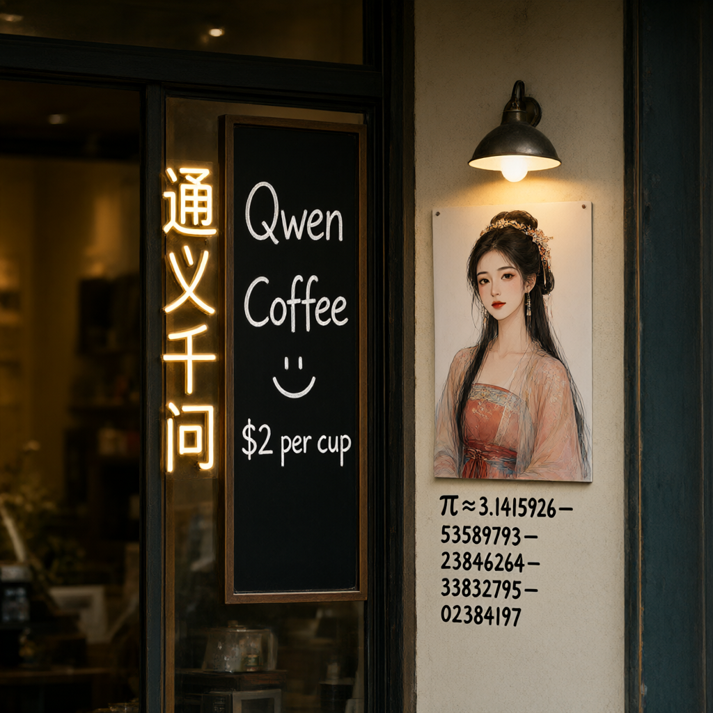
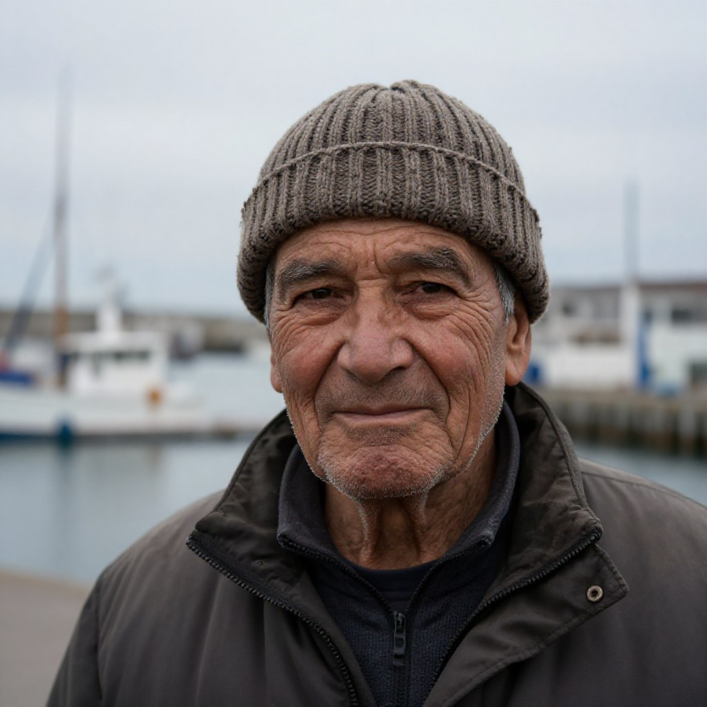
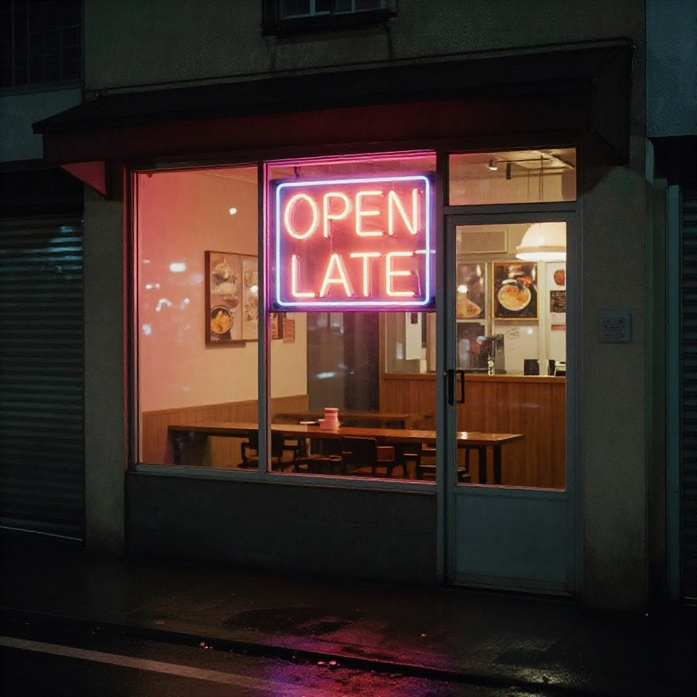
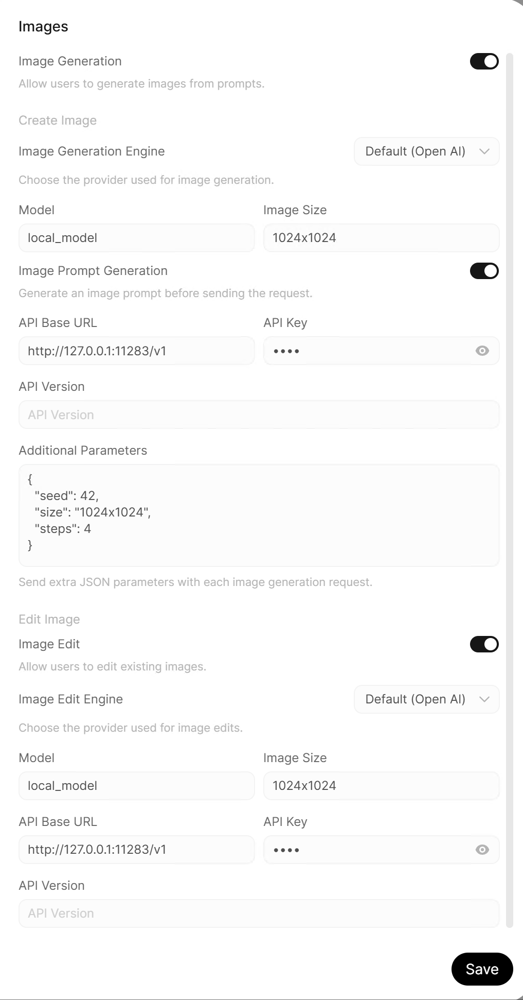

# VigenFlow

**FLUX and Z-Image on the NPU of an AMD Ryzen AI laptop, several times faster than the same laptop's integrated GPU.**

Local image generation and editing with **CPU + AMD NPU inference**, connected to **OpenWebUI Desktop**.

The latest release, **[v0.2.0 Beta 2](https://github.com/jia1217/vigenflow/releases/latest)**, adds **Krea 2 Turbo** as a fifth model and keeps the model weights in one folder that every VigenFlow version shares. All models use **BFP16 weights**, and **image editing** is served next to the text-to-image models.

> **Coming soon:** Qwen Image 2.1 Turbo text-to-image support in VigenFlow. See the three preview images below.

---

## 🎨 Gallery

The Qwen Image 2.1 Turbo images below preview the upcoming text-to-image release at 1024 × 1024. The exact input prompt is shown below each image.

<details open>
<summary><b>Qwen Image 2.1 Turbo — Coming soon</b></summary>
<br>
<table>
  <tr>
    <td width="33%" valign="top"><a href="assets/gallery/qwen_image_2_1_turbo_1.png"></a><br><sub>A photorealistic die-cut sticker of a 28-year-old Scandinavian woman with natural freckles and wind-blown blonde hair. She is looking directly at the camera, winking playfully, and holding up a clear peace sign with her hand. She is wearing a cozy oversized knit sweater. The image is shot on an 85mm lens with hyper-detailed skin texture, fine pores, and realistic studio lighting. The portrait is perfectly encased in a thick, crisp white outer sticker border. Completely isolated on a transparent background, pure alpha channel cutout, no background environment, floating, 8k resolution.</sub></td>
    <td width="33%" valign="top"><a href="assets/gallery/qwen_image_2_1_turbo_2.png"></a><br><sub>Create an open travel journal for Paris, France on a textured surface, featuring a passport page with a fictional decorative PARIS travel stamp and a 3D pop-up watercolor scene of the Eiffel Tower, a stone Seine bridge, rooftops of Montmartre, and a sidewalk cafe. Add a PARIS heading, pressed flowers, and vintage cultural icons around the header. Surround the journal with a metro ticket, a small brass compass, a fountain pen, an old postcard, and a sprig of lavender. Style: handcrafted travel scrapbook, rich watercolor, delicate ink lines, realistic paper texture, soft shadows, layered pop-up depth, nostalgic and elegant. Subject/variable fill: No people in the image.</sub></td>
    <td width="33%" valign="top"><a href="assets/gallery/qwen_image_2_1_turbo_3.png"></a><br><sub>A coffee shop entrance features a chalkboard sign reading "Qwen Coffee 😊 $2 per cup," with a neon light beside it displaying "通义千问". Next to it hangs a poster showing a beautiful Chinese woman, and beneath the poster is written "π≈3.1415926-53589793-23846264-33832795-02384197". Ultra HD, 4K, cinematic composition, Ultra HD, 4K, cinematic composition.</sub></td>
  </tr>
</table>
</details>

The released-model examples below were generated by VigenFlow on the NPU from the prompt shown under each image, at 1024 × 1024. The FLUX and Z-Image images come from v0.2.0 Beta 2 with the default settings (4 steps, seed 42), and the Krea 2 Turbo images use its 8 steps. Try the same prompts on your own NPU.

<details open>
<summary><b>FLUX.1-schnell</b></summary>
<br>
<table>
  <tr>
    <td width="33%" valign="top"><br><sub>A cozy reading nook by a rain-streaked window, warm lamp light, stacks of old books, a sleeping orange cat curled up on a knitted blanket, cinematic photo</sub></td>
    <td width="33%" valign="top"><br><sub>A red fox standing in a snowy pine forest at sunrise, soft golden light, its breath visible in the cold air, wildlife photography</sub></td>
    <td width="33%" valign="top"><br><sub>A watercolor painting of a small lighthouse on a rocky island, seagulls overhead, pastel sunset sky</sub></td>
  </tr>
</table>
</details>

<details>
<summary><b>FLUX.2-klein-4B</b></summary>
<br>
<table>
  <tr>
    <td width="33%" valign="top"><br><sub>A cafe chalkboard sign that says "FRESH COFFEE" in hand-lettered white chalk, a steaming cup of coffee beside it, warm morning light</sub></td>
    <td width="33%" valign="top"><br><sub>Macro photo of a dew-covered green leaf with a tiny ladybug, shallow depth of field, soft morning light</sub></td>
    <td width="33%" valign="top"><br><sub>Paper-cut art of a koi fish swimming among lotus flowers, layered colored paper, soft shadows between the layers</sub></td>
  </tr>
</table>
</details>

<details>
<summary><b>Krea 2 Turbo</b></summary>
<br>
<table>
  <tr>
    <td width="33%" valign="top"><br><sub>写实摄影，一位黑色长发的年轻亚洲女子站在阳光斑驳的森林中，头发自然披散在肩头并编成一条松散的长辫，用紫色发圈固定。她的皮肤白皙，嘴唇微张，笑容甜美，表情温柔。她身穿一袭白色露肩上衣，领口和袖口饰有精致蕾丝花边，胸前系着蝴蝶结，下摆微微收紧露出紫色腰带；脖子上戴着一条金色细链，坠着一枚椭圆形紫色宝石吊坠。她的右手轻轻捏住一朵紫色风铃草，花瓣舒展，花茎细长带有绿色叶片。柔和的金色阳光从左侧树叶间洒落，背景是朦胧的绿色树影与散景光点，整体画面呈现温暖、自然且梦幻的氛围.</sub></td>
    <td width="33%" valign="top"><br><sub>A vintage travel poster that says "VISIT KYOTO" in bold retro lettering, a red pagoda framed by cherry blossoms, muted earthy colors</sub></td>
    <td width="33%" valign="top"><br><sub>a red fox sitting in fresh snow, golden hour, photorealistic</sub></td>
  </tr>
</table>
</details>

<details>
<summary><b>Z-Image-Turbo</b></summary>
<br>
<table>
  <tr>
    <td width="33%" valign="top"><br><sub>Portrait photo of an elderly fisherman with a weathered face and a knitted wool cap, harbor in the background, overcast natural light, 85mm lens</sub></td>
    <td width="33%" valign="top"><br><sub>A neon sign reading "OPEN LATE" glowing in the window of a small ramen shop on a rainy street at night, reflections on the wet pavement</sub></td>
    <td width="33%" valign="top"><br><sub>A bowl of fresh fruit salad on a white marble countertop, top-down food photography, bright natural light</sub></td>
  </tr>
</table>
</details>

---

## 🎬 Demo

- ⚡ **[v0.2 speed demo](https://www.youtube.com/watch?v=2mQH2Q0H6Nc&list=PLcZNuhm1Td94)**: VigenFlow generating images on the NPU.
- 🛠️ **[Setup walkthrough](https://youtu.be/kZaqCE0LnRA?si=5h6zOFKBfm6EKJv9)**: how to set up and use VigenFlow with OpenWebUI Desktop.
<!-- - 📱 **[Short demo](https://youtube.com/shorts/dwDsCnBObzQ?si=Aq4BZV3zcW51KjQa)** -->

> **Note:** VigenFlow is tested with Open WebUI **v0.11.4**. If you use a different version and run into compatibility issues, switch to v0.11.4.

---

## 🧠 Supported Models

| Model | Model ID | Task | Denoising steps | Time per image |
| --- | --- | --- | ---: | ---: |
| **FLUX.1-schnell** | `flux1-schnell` | Text-to-image | 4 | ~20 s |
| **FLUX.2-klein-4B** | `flux2-klein-4B` | Text-to-image | 4 | ~9 s |
| **FLUX.2-klein-4B Edit** | `flux2-klein-4B-edit` | Image-to-image | 4 | ~18 s |
| **Krea 2 Turbo** | `krea2-turbo` | Text-to-image | 8 | ~50 s |
| **Z-Image-Turbo** | `z-image-turbo` | Text-to-image | 4 or 8 | ~18 s |

All models use BFP16 weights, run on both Windows and Ubuntu, and make 1024 × 1024 images. You can switch between them in the OpenWebUI model list without restarting `vgf-serve`.

The times are approximate, for one 1024 × 1024 image on an AMD Ryzen AI 9 HX 370, with prompts encoded at 512 text tokens.

Krea 2 Turbo's weights are under the [Krea 2 Community License](https://www.krea.ai/krea-2-licensing), not Apache-2.0, and its commercial use is limited; see [MODEL_LICENSES.md](MODEL_LICENSES.md). The other models are Apache-2.0.

### Compared with AMD Ryzen AI Software 1.8

AMD's [Ryzen AI Software 1.8](https://ryzenai.docs.amd.com/en/latest/sd_demo.html) runs FLUX.1-schnell and FLUX.2-klein-4B on the NPU as preview demos. On the same Ryzen AI 9 HX 370, VigenFlow is faster with prompts twice as long, and it also runs three models that Ryzen AI 1.8 does not:

| Model | VigenFlow | Ryzen AI Software 1.8 |
| --- | --- | --- |
| FLUX.1-schnell | ~20 s, 512 text tokens | ~23 s, 256 text tokens |
| FLUX.2-klein-4B | ~9 s, 512 text tokens | ~10 s, 256 text tokens |
| FLUX.2-klein-4B Edit | ~18 s | Not supported |
| Krea 2 Turbo | ~50 s | Not supported |
| Z-Image-Turbo | ~18 s | Not supported |

All times are for one 1024 × 1024 image, and both FLUX comparisons use 4 steps. In our tests, Ryzen AI 1.8's FLUX demos accept prompts of up to 256 text tokens. At the same 256 text tokens, VigenFlow's FLUX.2-klein-4B takes about 8 s; VigenFlow ships only the 512-token version so that longer prompts fit.

---

## 🔜 Next Steps

Planned for a future release:

- [ ] **Qwen Image 2.1 Turbo** text-to-image support — coming soon; preview images are in the [gallery](#-gallery).
- [ ] **SeedVR2** and **VOSR2** support for image upscaling.
- [ ] **LoRA support** for the BFP16 model pipelines. If you need LoRA today, use [v0.1.2](https://github.com/jia1217/vigenflow/releases/tag/v0.1.2).

---

## 🚀 Getting Started

Check that you have everything below before you download VigenFlow:

- [ ] **An AMD Ryzen AI 300-series processor** with an XDNA 2 NPU (`npu2`). VigenFlow is tested on the [AMD Ryzen AI 9 HX 370](https://www.amd.com/en/newsroom/press-releases/2024-10-10-amd-launches-new-ryzen-ai-pro-300-series-processo.html); other processors need matching NPU binaries and runtime support.
- [ ] **Windows x64 or Ubuntu 24.04 x86_64.**
- [ ] **The NPU driver is installed.**
  - Windows: install the NPU driver from AMD's [Driver Download](https://www.amd.com/en/support/download/drivers.html) page. **NPU Compute Accelerator Device** should then appear in Device Manager.
  - Ubuntu: install the AMD XDNA driver and XRT from the [Lemonade PPA](https://launchpad.net/~lemonade-team/+archive/ubuntu/stable), then reboot. Ubuntu has no official XRT packages, and the PPA's `amdxdna-dkms` driver replaces the one built into the kernel, which does not work with XRT 2.25 on some kernels (see [Troubleshooting](#-troubleshooting)). `xrt-smi examine` should then list the NPU.

    ```bash
    sudo add-apt-repository ppa:lemonade-team/stable
    sudo apt update
    sudo apt install amdxdna-dkms libxrt-npu2 libxrt-utils
    sudo reboot
    ```
- [ ] **About 75 GB of free disk space** for all four sets of model weights: 65 GB of weights, plus up to 10 GB while downloading. You can download fewer models (see [Step 3](#-step-3-download-the-model-weights-one-time)).
- [ ] **OpenWebUI Desktop** is installed.

---

## 🐳 Quick Install with Docker (Ubuntu)

If you use Docker or Podman, or just want the quickest way to try VigenFlow on Ubuntu, one command sets everything up:

```bash
curl -fsSL https://raw.githubusercontent.com/jia1217/vigenflow/main/docker/install.sh | bash
```

The installer checks for the NPU driver and offers to install it, installs Docker if you have neither Docker nor Podman, asks which models to download (press Enter for FLUX.2-klein-4B, 8 GB), and starts VigenFlow together with OpenWebUI. When it finishes, open the address it prints, usually http://localhost:8080. Run the same command again to update VigenFlow or add models.

[docs/docker.md](docs/docker.md) shows the same steps by hand, with Podman and Docker Compose. To use the release packages instead, follow the steps below.

---

## 📦 Installation

Download the package for your system, extract it, download the model weights once, and start the server. The weights are not included in the packages; Step 3 downloads them from Hugging Face.

### 📥 Step 1: Download the Release Package

Go to the [Latest Release](https://github.com/jia1217/vigenflow/releases/latest) page and download the package for your operating system:

- 🐧 Ubuntu: `vigenflow_0.2.0-beta.2_ubuntu_amd64.zip`
- 🪟 Windows: `vigenflow_0.2.0-beta.2_windows_amd64.zip`

To be notified about new releases, click **Watch → Custom → Releases** on the [VigenFlow repository](https://github.com/jia1217/vigenflow) page.

### 📂 Step 2: Extract the Package

Extract the downloaded `.zip` package on a drive with room for the model weights. Step 3 saves them next to the extracted folder, not inside it.

#### 🐧 Ubuntu

The Ubuntu package needs a few runtime libraries. XRT comes with the AMD XDNA driver installation from [Getting Started](#-getting-started).

```bash
sudo apt install libboost-program-options1.83.0 libgomp1 libpng16-16t64 curl unzip
unzip vigenflow_0.2.0-beta.2_ubuntu_amd64.zip
cd vigenflow_0.2.0-beta.2_ubuntu_amd64
```

#### 🪟 Windows

Extract the ZIP package manually, then open **PowerShell** inside the extracted `vigenflow_0.2.0-beta.2_windows_amd64` folder.

### 💾 Step 3: Download the Model Weights (One Time)

`prepare_base.exe` downloads the pre-packed NPU weights from Hugging Face and saves them in an `all_model_weights` folder **next to** the extracted package folder, so a later VigenFlow version extracted in the same place uses the same weights. Each model has its own repository: [FLUX.1-schnell](https://huggingface.co/Kelsey1217/FLUX.1-schnell-NPU-BFP16), [FLUX.2-klein-4B](https://huggingface.co/Kelsey1217/FLUX.2-klein-4B-NPU-BFP16), [Z-Image-Turbo](https://huggingface.co/Kelsey1217/Z-Image-Turbo-NPU-BFP16) and [Krea 2 Turbo](https://huggingface.co/Kelsey1217/Krea-2-Turbo-NPU-BFP16). No Hugging Face account is needed.

#### 🐧 Ubuntu

```bash
./prepare/prepare_base.exe
```

#### 🪟 Windows

```powershell
.\prepare\prepare_base.exe
```

When the download reaches Krea 2 Turbo, `prepare_base.exe` shows the Krea license links and waits for you to type `I agree`. Any other answer skips that model.

All four sets of weights together are about **65 GB** (FLUX.1-schnell 27 GB, Krea 2 Turbo 19 GB, Z-Image-Turbo 12 GB, FLUX.2-klein-4B 8 GB), plus up to 10 GB of free space while downloading. The edit model uses the FLUX.2-klein-4B weights.

To download only some models, name their weight folders with `--only`, for example `prepare_base.exe --only flux2_klein_4B,z_image_turbo`. The names are `flux1_schnell`, `flux2_klein_4B`, `z_image_turbo` and `krea2_turbo`. To skip a model on every run, set `"enabled": false` for it in `prepare/prepare_models.jsonc` instead.

If you used v0.2.0 Beta 1, move its `all_model_weights` folder so that it sits next to the new package folder before you run the command. The three models you already have are then not downloaded again.

You can run `prepare_base.exe` again at any time. It only downloads models whose weights have changed, and it resumes an interrupted download.

### ▶️ Step 4: Launch VigenFlow Server

All models are served at once, so you don't need to give a model name when starting the server.

#### 🐧 Ubuntu

```bash
cd server_running
./vgf-serve
```

#### 🪟 Windows

```powershell
cd server_running
.\vgf-serve.exe
```

The server listens on port **11283** and makes all supported models available to OpenWebUI. To see all server options, run `./vgf-serve -h` (Ubuntu) or `.\vgf-serve.exe -h` (Windows).

The default model is `z-image-turbo`. If you did not download its weights, start the server with `--model` and the ID of a model you have, for example `--model flux2-klein-4B`.

---

## 🔗 Connect with OpenWebUI Desktop

After launching `vgf-serve`, open **OpenWebUI Desktop** and configure it for your local VigenFlow server. All settings below are in OpenWebUI's **Admin Panel → Settings**.

1. **Add the connection.** In **Connections**, add an OpenAI API connection with this URL:

   ```text
   http://127.0.0.1:11283/v1
   ```

   Keep **API Type** set to **Chat Completions** (the default). No API key is needed. The VigenFlow models then appear in the model list.
2. **Turn on image generation.** In **Images**, turn on **Image Generation**, keep the engine set to **OpenAI**, set the API base URL to `http://127.0.0.1:11283/v1`, and type any text as the API key, then click **Save**. OpenWebUI will not save this setting without a key; VigenFlow ignores it.
3. **Set up each model.** In **Models**, edit each VigenFlow model:
   - Set **Function Calling** to **Native** in its advanced parameters. Recent OpenWebUI versions already use Native by default.
   - Keep **Image Generation** and **Builtin Tools** checked under Capabilities.
   - For `flux2-klein-4B-edit`, also check **Vision** so you can attach images.
4. **Generate an image.** In a chat, pick a VigenFlow model, open **Integrations** in the message box and turn on **Image**, then type your prompt.

The screenshot shows the **Images** settings page set up for VigenFlow.



---

## 🔧 Troubleshooting

### Ubuntu: `run.exe failed with exit code 134` for every model

The AMD XDNA driver built into some Linux kernels rejects the messages that XRT 2.25 sends to the NPU. This was reported on kernel `7.0.0-38`. Every model worker then stops, `vgf-serve` prints `run.exe failed with exit code 134`, and `sudo dmesg` shows lines like these:

```text
Message callback ret -22
Channel in bad state
```

To fix it, install the driver from the Lemonade PPA and reboot. The `amdxdna-dkms` package builds the driver for your kernel, and it is loaded instead of the built-in one:

```bash
sudo add-apt-repository ppa:lemonade-team/stable
sudo apt update
sudo apt install amdxdna-dkms
sudo reboot
```

After the reboot, `modinfo -n amdxdna` should print a path that contains `updates/dkms`, and `xrt-smi examine` should list the NPU.

---

## 📄 License

The VigenFlow source code is licensed under the [Apache License 2.0](LICENSE).

Model weights are **not** covered by this license. Each model and LoRA keeps its original license, including the BFP16 weights in the release packages. See [MODEL_LICENSES.md](MODEL_LICENSES.md) for each model's license and whether it allows commercial use. Third-party libraries are listed in [THIRD_PARTY_NOTICES.md](THIRD_PARTY_NOTICES.md).
