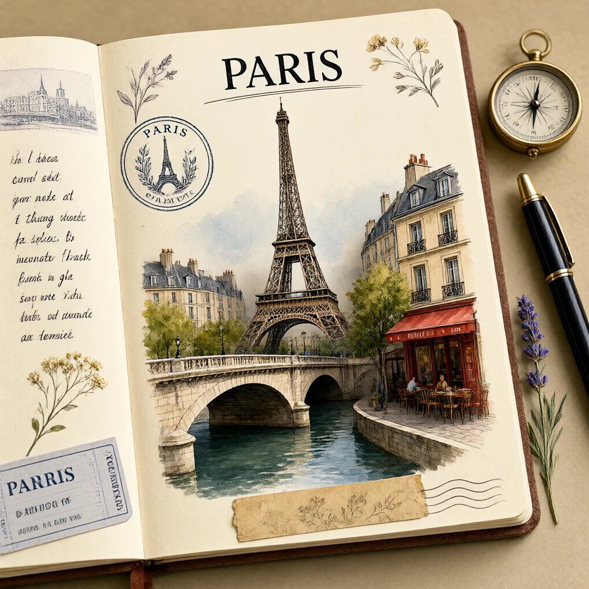

# Gallery

Every image here was generated by VigenFlow on the NPU at 1024 × 1024 from the prompt shown under it; each edit also starts from the input image shown first in its row. The FLUX and Z-Image images use v0.2.0 Beta 2's default settings (4 steps, seed 42). Krea 2 Turbo and Qwen Image 2.1 Turbo, including its edit model, use their 8 steps. Click an image to open it at full size, and try the same prompts on your own NPU.

The [README gallery](../README.md#-gallery) shows one image per model.

**Text-to-image:** [FLUX.1-schnell](#flux1-schnell) · [FLUX.2-klein-4B](#flux2-klein-4b) · [Krea 2 Turbo](#krea-2-turbo) · [Qwen Image 2.1 Turbo](#qwen-image-21-turbo) · [Z-Image-Turbo](#z-image-turbo)

**Image editing:** [Qwen Image 2.1 Turbo Edit](#qwen-image-21-turbo-edit)

## Text-to-Image

### FLUX.1-schnell

<table>
  <tr>
    <td width="33%" valign="top"> A cozy reading nook by a rain-streaked window, warm lamp light, stacks of old books, a sleeping orange cat curled up on a knitted blanket, cinematic photo</td>
    <td width="33%" valign="top"> A red fox standing in a snowy pine forest at sunrise, soft golden light, its breath visible in the cold air, wildlife photography</td>
    <td width="33%" valign="top"> A watercolor painting of a small lighthouse on a rocky island, seagulls overhead, pastel sunset sky</td>
  </tr>
</table>

### FLUX.2-klein-4B

<table>
  <tr>
    <td width="33%" valign="top"> A cafe chalkboard sign that says "FRESH COFFEE" in hand-lettered white chalk, a steaming cup of coffee beside it, warm morning light</td>
    <td width="33%" valign="top"> Macro photo of a dew-covered green leaf with a tiny ladybug, shallow depth of field, soft morning light</td>
    <td width="33%" valign="top"> Paper-cut art of a koi fish swimming among lotus flowers, layered colored paper, soft shadows between the layers</td>
  </tr>
</table>

### Krea 2 Turbo

<table>
  <tr>
    <td width="33%" valign="top"> 写实摄影，一位黑色长发的年轻亚洲女子站在阳光斑驳的森林中，头发自然披散在肩头并编成一条松散的长辫，用紫色发圈固定。她的皮肤白皙，嘴唇微张，笑容甜美，表情温柔。她身穿一袭白色露肩上衣，领口和袖口饰有精致蕾丝花边，胸前系着蝴蝶结，下摆微微收紧露出紫色腰带；脖子上戴着一条金色细链，坠着一枚椭圆形紫色宝石吊坠。她的右手轻轻捏住一朵紫色风铃草，花瓣舒展，花茎细长带有绿色叶片。柔和的金色阳光从左侧树叶间洒落，背景是朦胧的绿色树影与散景光点，整体画面呈现温暖、自然且梦幻的氛围.</td>
    <td width="33%" valign="top"> A vintage travel poster that says "VISIT KYOTO" in bold retro lettering, a red pagoda framed by cherry blossoms, muted earthy colors</td>
    <td width="33%" valign="top"> a red fox sitting in fresh snow, golden hour, photorealistic</td>
  </tr>
</table>

### Qwen Image 2.1 Turbo

<table>
  <tr>
    <td width="33%" valign="top"> A photorealistic die-cut sticker of a 28-year-old Scandinavian woman with natural freckles and wind-blown blonde hair. She is looking directly at the camera, winking playfully, and holding up a clear peace sign with her hand. She is wearing a cozy oversized knit sweater. The image is shot on an 85mm lens with hyper-detailed skin texture, fine pores, and realistic studio lighting. The portrait is perfectly encased in a thick, crisp white outer sticker border. Completely isolated on a transparent background, pure alpha channel cutout, no background environment, floating, 8k resolution.</td>
    <td width="33%" valign="top"> Create an open travel journal for Paris, France on a textured surface, featuring a passport page with a fictional decorative PARIS travel stamp and a 3D pop-up watercolor scene of the Eiffel Tower, a stone Seine bridge, rooftops of Montmartre, and a sidewalk cafe. Add a PARIS heading, pressed flowers, and vintage cultural icons around the header. Surround the journal with a metro ticket, a small brass compass, a fountain pen, an old postcard, and a sprig of lavender. Style: handcrafted travel scrapbook, rich watercolor, delicate ink lines, realistic paper texture, soft shadows, layered pop-up depth, nostalgic and elegant. Subject/variable fill: No people in the image.</td>
    <td width="33%" valign="top"> A coffee shop entrance features a chalkboard sign reading "Qwen Coffee 😊 $2 per cup," with a neon light beside it displaying "通义千问". Next to it hangs a poster showing a beautiful Chinese woman, and beneath the poster is written "π≈3.1415926-53589793-23846264-33832795-02384197". Ultra HD, 4K, cinematic composition, Ultra HD, 4K, cinematic composition.</td>
  </tr>
</table>

### Z-Image-Turbo

<table>
  <tr>
    <td width="33%" valign="top"> Portrait photo of an elderly fisherman with a weathered face and a knitted wool cap, harbor in the background, overcast natural light, 85mm lens</td>
    <td width="33%" valign="top"> A neon sign reading "OPEN LATE" glowing in the window of a small ramen shop on a rainy street at night, reflections on the wet pavement</td>
    <td width="33%" valign="top"> A bowl of fresh fruit salad on a white marble countertop, top-down food photography, bright natural light</td>
  </tr>
</table>

## Image Editing

### Qwen Image 2.1 Turbo Edit

All three edits start from the first [Krea 2 Turbo](#krea-2-turbo) image.

<table>
  <tr>
    <td width="25%" valign="top"> <b>Input image</b></td>
    <td width="25%" valign="top"> 生成这个角色的全身照</td>
    <td width="25%" valign="top"> Transform the person in the reference photo into a full-color Japanese manga character. Preserve their recognizable identity, including face shape, hairstyle, distinctive facial features, apparent age, and expression. Keep the original pose, clothing, accessories, and camera angle. Retain the photo’s skin tone, eye color, hair color, and clothing colors. Use crisp ink outlines, varied line weight, expressive eyes, carefully drawn hair strands, and polished cel shading with soft highlights. Preserve the original lighting and overall color palette. Simplify the background into a colored manga illustration while retaining the setting. Maintain natural anatomy and subtle facial stylization so the result clearly looks like the same person. Create a professional manga illustration with rich, balanced colors and no text or speech bubbles.</td>
    <td width="25%" valign="top"> 把她的裙子换成粉色</td>
  </tr>
</table>
