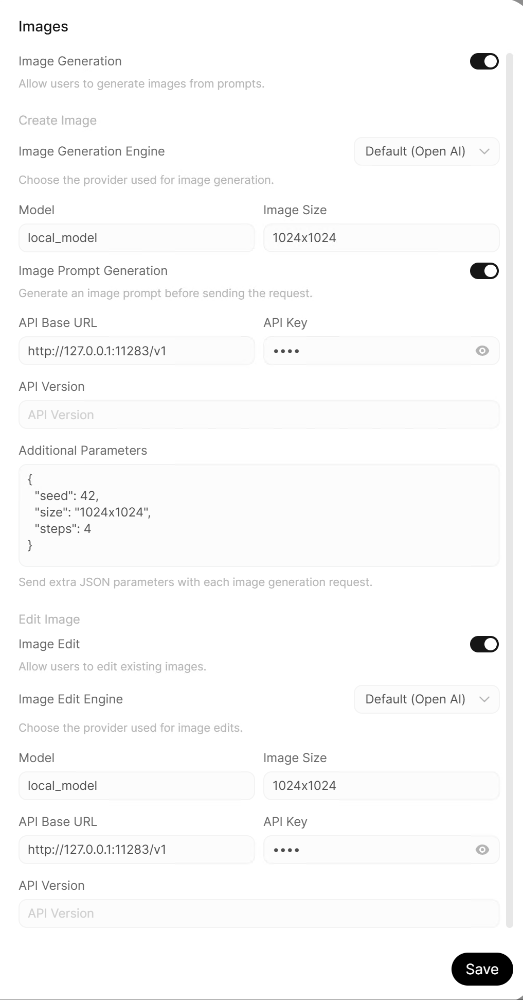

# Connect with OpenWebUI Desktop (Optional)

[← Back to VigenFlow](../README.md) · [Installation](installation.md)

After launching `vgf-serve`, open **OpenWebUI Desktop** and configure it for your local VigenFlow server. All settings below are in OpenWebUI's **Admin Panel → Settings**.

The steps below use port **11283**. If you started the server on another port, use that port in both API URLs. The Beta 4 `start.sh` launcher defaults to **11285**.

1. **Add the connection.** In **Connections**, add an OpenAI API connection with this URL:

   ```text
   http://127.0.0.1:11283/v1
   ```

   Keep **API Type** set to **Chat Completions** (the default). No API key is needed. The VigenFlow models then appear in the model list.
2. **Turn on image generation.** In **Images**, turn on **Image Generation**, keep the engine set to **OpenAI**, set the API base URL to `http://127.0.0.1:11283/v1`, and type any text as the API key, then click **Save**. OpenWebUI will not save this setting without a key; VigenFlow ignores it.
3. **Set up each model.** In **Models**, edit each VigenFlow model:
   - Set **Function Calling** to **Native** in its advanced parameters. Recent OpenWebUI versions already use Native by default.
   - Keep **Image Generation** and **Builtin Tools** checked under Capabilities.
   - For `flux2-klein-4B-edit`, also check **Vision** so you can attach images.
4. **Generate an image.** In a chat, pick a VigenFlow model, open **Integrations** in the message box and turn on **Image**, then type your prompt.

The screenshot shows the **Images** settings page set up for VigenFlow.


